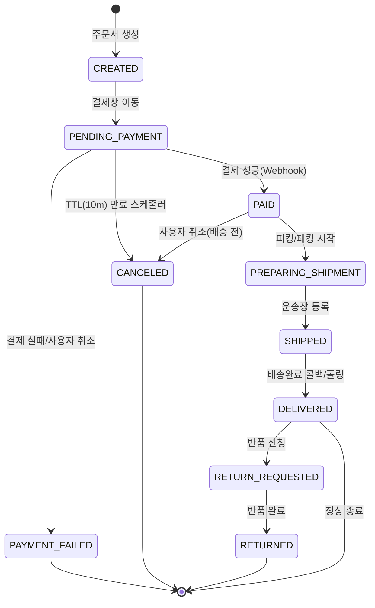
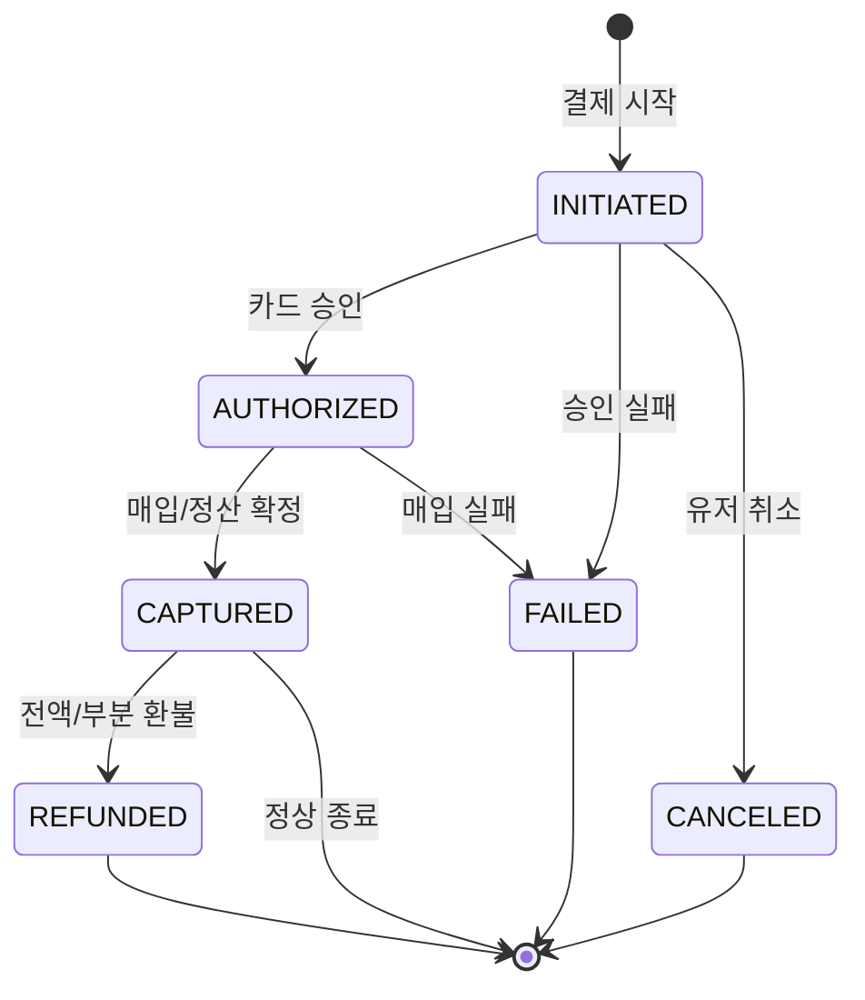
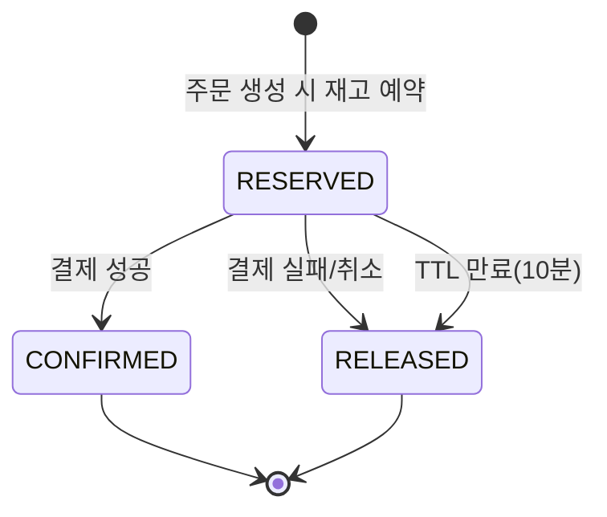
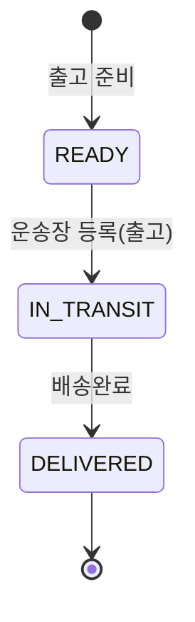

# 상태 다이어그램

### 3.1 주문 상태
- 주문이 생성된 후 결제, 배송을 거쳐 완료되거나 취소/반품되기 까지의 전체 핵심 흐름을 정의한다.

### 3.2 결제 상태
- 결제 요청이 시작되어 카드사 승인, 실제 매입(정산)까지 이어지는 금융 트랜잭션의 상세 상태를 모델링한다.

### 3.3 재고 예약 상태
- 주문 시 재고를 임시 선점(예약)했다가 결제 결과에 따라 확정하거나 해제하는 짧은 생명주기를 정의한다.

### 3.4 배송 상태
- 결제가 완료된 주문 상품이 출고 준비부터 고객에게 전달되기까지의 물리적인 배송 과정을 추적한다.
