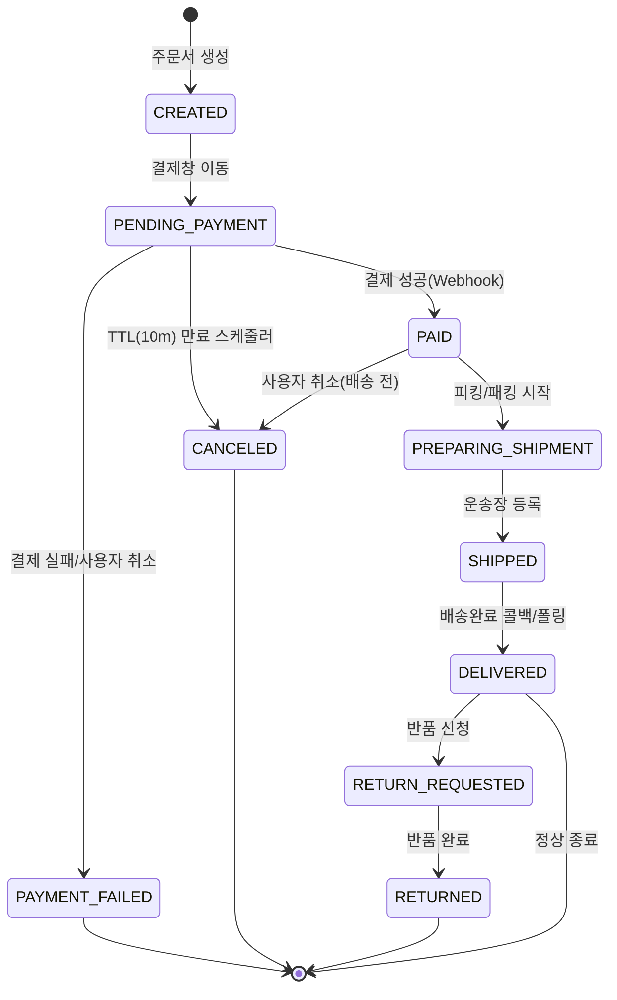
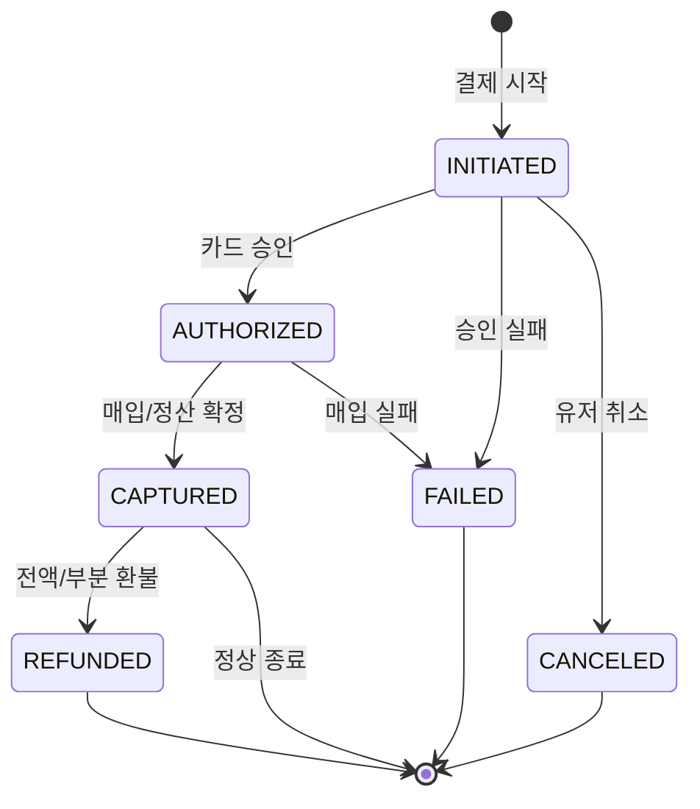
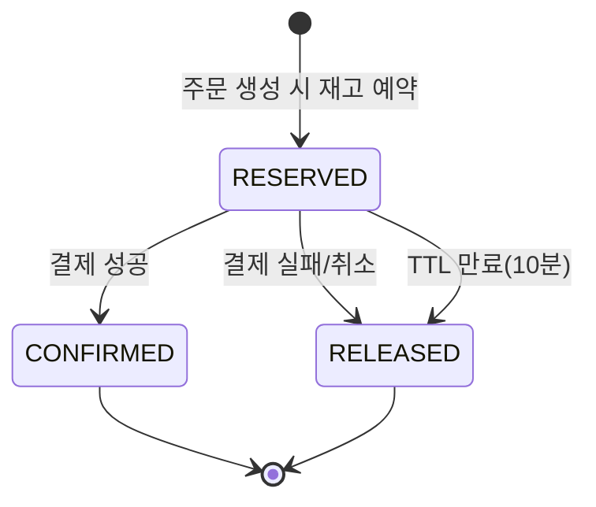
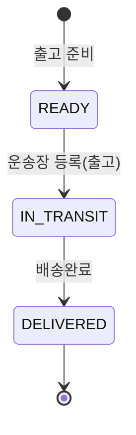
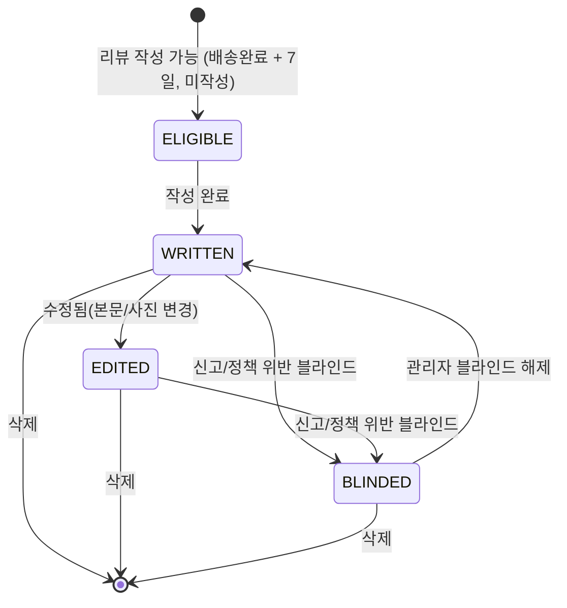
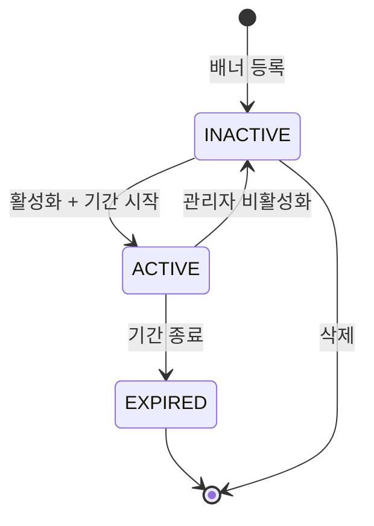
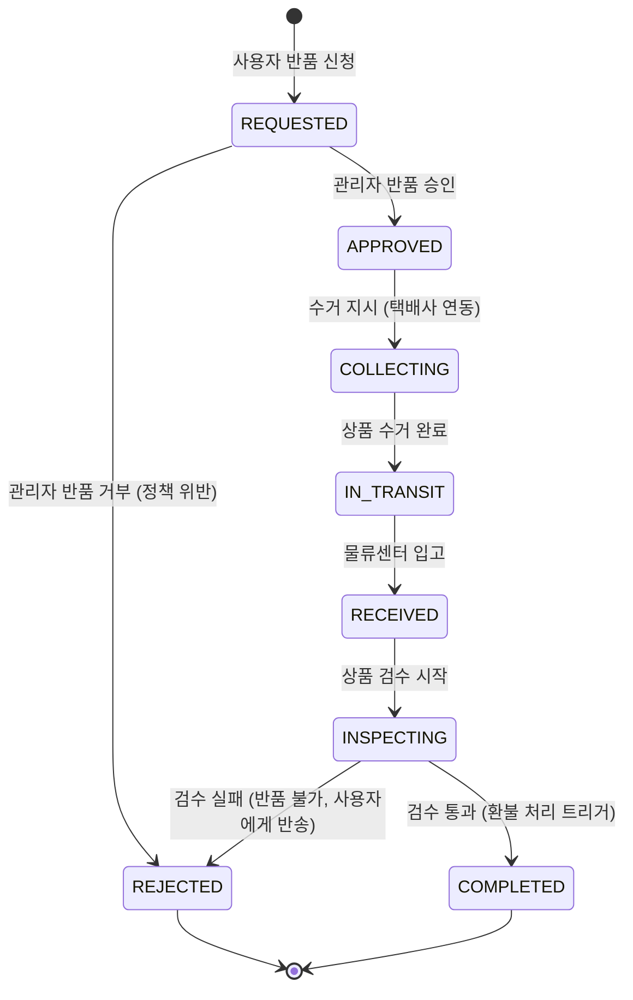
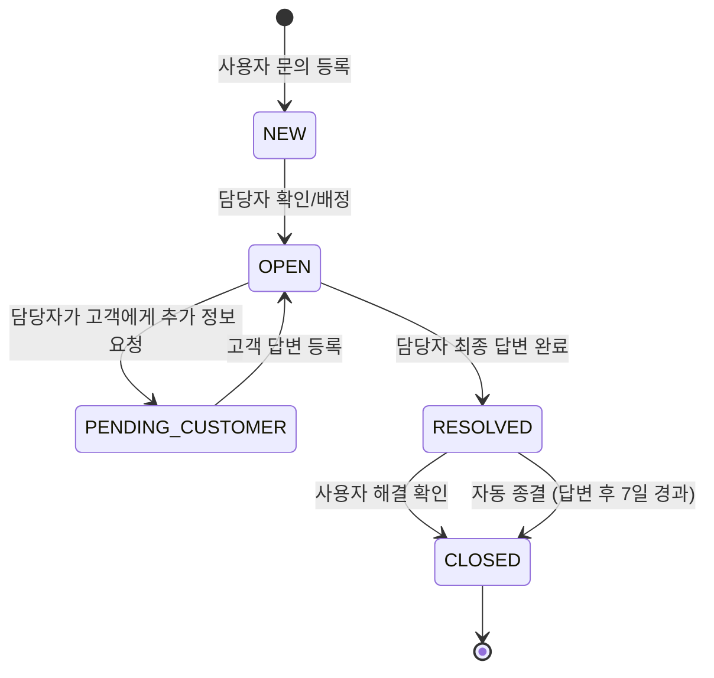

# 상태 다이어그램

### 3.1 주문 상태
- 주문이 생성된 후 결제, 배송을 거쳐 완료되거나 취소/반품되기 까지의 전체 핵심 흐름을 정의한다.

### 3.2 결제 상태
- 결제 요청이 시작되어 카드사 승인, 실제 매입(정산)까지 이어지는 금융 트랜잭션의 상세 상태를 모델링한다.

### 3.3 재고 예약 상태
- 주문 시 재고를 임시 선점(예약)했다가 결제 결과에 따라 확정하거나 해제하는 짧은 생명주기를 정의한다.

### 3.4 배송 상태
- 결제가 완료된 주문 상품이 출고 준비부터 고객에게 전달되기까지의 물리적인 배송 과정을 추적한다.

### 3.5 리뷰 운영 상태
- 리뷰 작성 가능 조건부터 작성 후 수정, 신고, 블라인드 처리 등 운영 관점에서의 콘텐츠 상태 변화를 정의한다.

### 3.6 배너 라이프 사이클
- 관리자가 등록한 배너가 설정된 노출 기간과 활성 상태에 따라 어떻게 사용자에게 보여지는지를 정의한다.

### 3.7 반품 처리 상태
- 사용자가 반품을 요청한 시점부터 상품 회수, 검수, 그리고 최종 환불 완료까지의 복잡한 과정을 모델링한다.

### 3.8 문의 처리 상태
- 고객의 문의가 접수된 후, 담당자가 배정되고 답변이 완료되어 종결되기까지의 고객 서비스 티켓 흐름을 정의한다.
